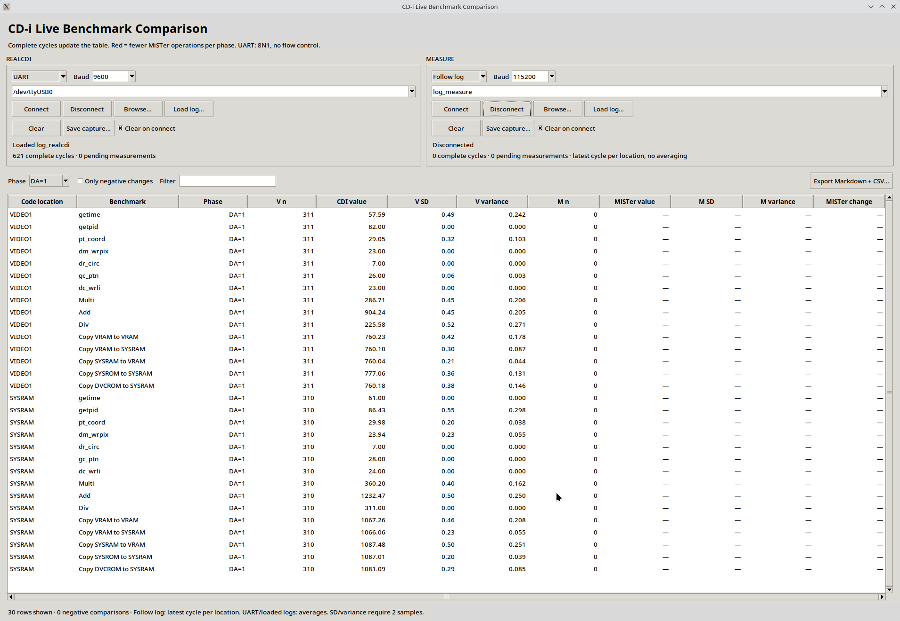

# CD-i CPU Speed and Memory Benchmark

This application executes various benchmarks on a CD-i.
It is meant to be useful for emulator developers

* Can be stub loaded or executed from disc
* Has 2 active video planes to cause pressure on the memory
* Measures difference between active display and vblank phase
* Measures difference between execution from Video RAM and DVC RAM
* Disables IRQs via custom trap handler to avoid disturbance by OS

The output looks like this:

	[VIDEO1] getime 8 58
	[VIDEO1] getpid 10 83
	[VIDEO1] pt_coord 3 29
	[VIDEO1] dm_wrpix 3 23
	[VIDEO1] dr_circ 1 7
	[VIDEO1] gc_ptn 4 27
	[VIDEO1] dc_wrli 3 24
	[VIDEO1] Multi 39 293
	[VIDEO1] Add 129 930
	[VIDEO1] Div 34 245
	[VIDEO1] Copy VRAM to VRAM 114 779
	[VIDEO1] Copy VRAM to SYSRAM 114 795
	[VIDEO1] Copy SYSRAM to VRAM 114 795
	[VIDEO1] Copy SYSROM to SYSRAM 114 817
	[VIDEO1] Copy DVCROM to SYSRAM 114 817
	-----
	[SYSRAM] getime 8 61
	[SYSRAM] getpid 10 87
	[SYSRAM] pt_coord 3 30
	[SYSRAM] dm_wrpix 3 24
	[SYSRAM] dr_circ 1 7
	[SYSRAM] gc_ptn 4 28
	[SYSRAM] dc_wrli 3 24
	[SYSRAM] Multi 42 360
	[SYSRAM] Add 141 1233
	[SYSRAM] Div 36 311
	[SYSRAM] Copy VRAM to VRAM 124 1067
	[SYSRAM] Copy VRAM to SYSRAM 123 1067
	[SYSRAM] Copy SYSRAM to VRAM 124 1088
	[SYSRAM] Copy SYSROM to SYSRAM 124 1087
	[SYSRAM] Copy DVCROM to SYSRAM 124 1087
	-----

The format is like this. DA is named after the Display Active bit of the MCD212

	[code location] <Benchmark> <DA0 count> <DA1 count>

When this project was started, these numbers were evaluated manually.
But now, there are more options

## Generation of statistics

Generates a Markdown file with deviations from recordings from a 210/05 player equipped with a VMPEG DVC.
An [example file is provided with this repo](benchmark_results/comparison.md), which was recorded using a MiSTer

	python3 benchmark_results/analyze.py

## Live benchmark GUI

This tool can either connect to the UART or follow a log.
For developing an emulator, write the output of the UART to a file
and connect to it for continuous inspection.

	python3 benchmark_results/live_gui.py

## Compiling under Linux

### Prerequisites

Clone https://github.com/TwBurn/cdi-sdk and have it mounted as D: drive in winecfg.

the resulting image to CUE/BIN for usage with MAME and MiSTer.
It is expected to have tocsplit.exe in the root of this project.

### Compiling

	WINEPATH=D:/DOS/BIN wine D:/dos/bin/bmake.exe link_app
	WINEPATH=D:/DOS/BIN wine D:/dos/bin/bmake.exe link_cd

### Starting via serial stub

	./stub_load.sh 

### Cleanup

	WINEPATH=D:/DOS/BIN wine D:/dos/bin/bmake.exe clean

### Authoring a disc image

	./make_image.sh

The resulting image can be loaded into cdiemu, MAME and the MiSTer FPGA

### Start image on MAME

	mame cdimono1 -cdrom disk/CPUBENCH.CUE

### Start image on cdiemu

	wine wcdiemu-v053b8.exe CPUBENCH.CDI -playcdi -start -term uart

### Copy to MiSTer

	scp disk/CPUBENCH.CUE disk/CPUBENCH.BIN root@mister:/media/fat/games/CD-i

## Resources

The base of this project was
https://github.com/TwBurn/Nobelia/

## AI Disclaimer

ChatGPT was used to generate the Python scripts in the project and also the assembler code for the trap handler

